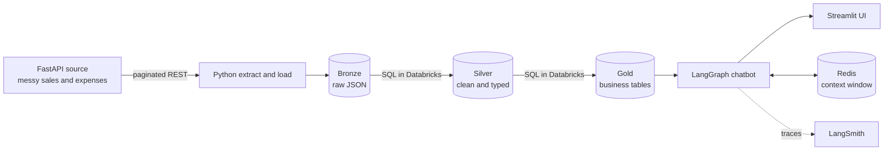
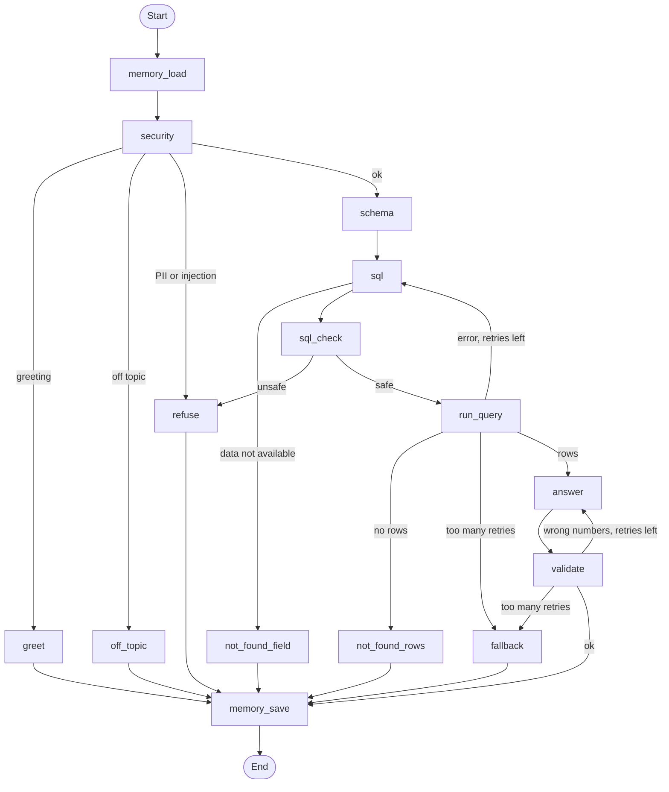

# Company Financials AI

An end to end data and AI project: a messy source API, an ELT pipeline into Databricks with bronze, silver and gold layers, and a LangGraph chatbot that answers business questions about the data in plain language.

Ask things like **"Which companies made a loss in September?"** and get an answer built from real query results, not guesses.


## Architecture



## Project structure

```
company-financials-ai/
  api/        FastAPI service that generates and serves the messy data
  elt/        Extract and load scripts, plus silver.sql and gold.sql
  chatbot/    LangGraph agent, Redis memory and the Streamlit app
```

## 1. Source API (`api/`)

A FastAPI service that generates 90 days of sales and monthly expenses for five fictional companies selling 13 products across 5 categories.

Data quality problems are planted on purpose, so the pipeline has real cleaning to do:

* Null values in dates, companies, prices, regions and customer IDs
* About 3% duplicate orders, where the same ID can appear as `42`, `"42"` or `42.0`
* Wrong data types, such as `"Rs 3,999"` in price columns and `"10%"` in discounts
* Three date formats and three month formats
* Invalid quantities (0, negative and 999) and wrong profit values
* A returned flag written six different ways
* Unwanted columns like `legacy_sku`, `ui_color` and `_internal_row_hash`

| Endpoint | Description |
|---|---|
| `GET /orders?page=1&page_size=500` | Paginated orders |
| `GET /orders/{order_id}` | One order, 404 if missing |
| `GET /expenses?page=1&page_size=500` | Paginated monthly expenses |
| `GET /products` | Product catalogue |
| `GET /companies` | Company list |

## 2. ELT pipeline (`elt/`)

**Extract and load** in Python: the script calls every page of the API and lands each record unchanged as raw JSON in Databricks, with the endpoint, page number, batch ID and ingestion time.

**Transform** in SQL, inside Databricks:

| Layer | Tables | What happens |
|---|---|---|
| Bronze | `orders_raw`, `expenses_raw` | Raw JSON exactly as received, append only |
| Silver | `orders`, `expenses` | Reads the latest batch only, extracts JSON fields, casts types, parses all date formats, cleans text and money values, removes duplicates after casting IDs, fills missing product details by product ID, recalculates revenue, cost and profit, flags bad rows with `is_valid` and `profit_mismatch` |
| Gold | `company_daily_sales`, `product_performance`, `company_monthly_pnl` | Daily sales with 7 day averages and month to date totals, product rankings by category, and a monthly profit and loss statement per company |

**Data quality results**

| Check | Result |
|---|---|
| Rows loaded | 1,402 |
| Duplicates removed | 45 |
| Orders in silver | 1,357 |
| Invalid rows flagged | 87 |
| Wrong profit values caught | 25 |

Bad rows are flagged, not deleted, so they can still be counted and investigated. Gold only uses valid rows.

## 3. AI chatbot (`chatbot/`)

A LangGraph agent that turns a question into SQL, runs it on the gold tables and explains the result.



**Key design choices**

* **Layered security:** regex catches emails and phone numbers, an LLM check catches prompt injection and off topic questions, and a plain Python SQL guard allows SELECT queries only. The guard cannot be talked out of its job, unlike an LLM.
* **Small schema, not the whole database:** the LLM only sees a short description of the three gold tables, so prompts stay small and only query results come back.
* **Self correcting SQL:** if Databricks returns an error, the error is fed back to the LLM to fix its query, up to 3 retries.
* **Grounded answers:** a plain Python check confirms every number in the answer exists in the query results, allowing for rounding.
* **Two not found paths:** one for data that does not exist in the tables, one for valid questions that match no rows.
* **Context window in Redis:** the last 10 turns of each chat, with a 30 minute expiry, so follow ups like "and August?" work.
* **Streaming:** answer tokens stream into Streamlit as they are generated.
* **Tracing:** every run is traced in LangSmith, with each node, prompt, token count and timing.


**Sample questions**

* Which companies made a loss in September?
* What are the top 5 most profitable products?
* Which product category brings in the most revenue?
* What were Everest Electronics' total sales in October? Then: and in September?

## Tech stack

Python, FastAPI, Databricks (SQL warehouse, Delta tables), SQL, LangGraph, LangChain, OpenRouter, Redis, LangSmith, Streamlit, Docker, uv

## How to run

**Requirements:** Python 3.12, [uv](https://docs.astral.sh/uv/), Docker, a Databricks workspace with a SQL warehouse, and an OpenRouter API key.

**1. Start the API**

```bash
cd api
uv sync
uv run uvicorn api:app --reload
```

API docs: http://127.0.0.1:8000/docs

**2. Run the ELT pipeline**

```bash
cd elt
cp .env.example .env     # add your Databricks values
uv sync
uv run main.py
```

Then run `silver.sql` and then `gold.sql` in the Databricks SQL editor.

**3. Start the chatbot**

```bash
docker run -d --name redis -p 6379:6379 redis:7
cd chatbot
cp .env.example .env     # add Databricks, OpenRouter and LangSmith values
uv sync
uv run streamlit run app.py
```

For a quick terminal test, run `uv run graph.py`.

## Environment variables

| Variable | Used in | Purpose |
|---|---|---|
| `DATABRICKS_HOST` | elt, chatbot | Workspace hostname |
| `DATABRICKS_HTTP_PATH` | elt, chatbot | SQL warehouse HTTP path |
| `DATABRICKS_TOKEN` | elt, chatbot | Personal access token |
| `API_BASE_URL` | elt | Source API address, default `http://127.0.0.1:8000` |
| `OPENROUTER_API_KEY` | chatbot | LLM access |
| `OPENROUTER_MODEL` | chatbot | For example `openai/gpt-4o-mini` |
| `REDIS_URL` | chatbot | Default `redis://localhost:6379/0` |
| `LANGSMITH_TRACING`, `LANGSMITH_API_KEY`, `LANGSMITH_PROJECT` | chatbot | Optional tracing |

## Lessons learned

* **Test each layer on its own.** The chatbot once failed every profit and loss question after 3 retries. LangSmith showed the query step repeating, and a known good query run directly against Databricks returned "table not found": two gold tables had never been created.
* **The LangGraph state is a contract.** A node can only write keys declared in the state. Undeclared keys are silently dropped, which caused a `KeyError` further down the graph.
* **Use plain code where it fits.** Replacing an LLM based answer check with a Python check made answers faster, cheaper and more reliable, since the LLM was rejecting correct answers for rounding.

## Limitations and next steps

* The first and last months are partial, so their profit and loss figures look worse than full months
* Products are not linked to individual companies in the gold tables
* Next: an encoder model for prompt injection detection, an MCP server exposing the gold tables as tools, and scheduled orchestration for the pipeline

## Author

**Suyog Subedi**, final year BSc (Hons) Computing with Artificial Intelligence, Kathmandu, Nepal
[GitHub](https://github.com/SuyogSubedi21) · [LinkedIn](https://linkedin.com/in/suyog-subedi-724510316)